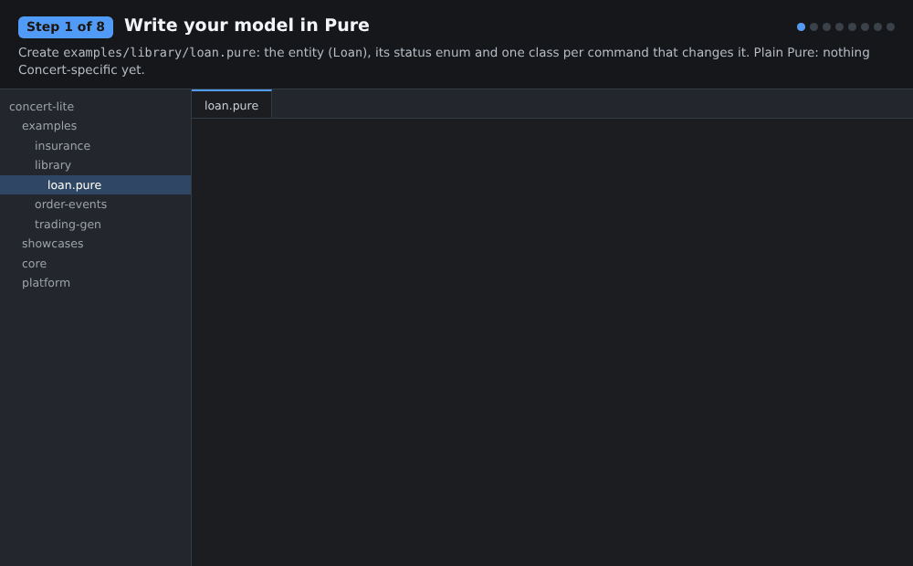
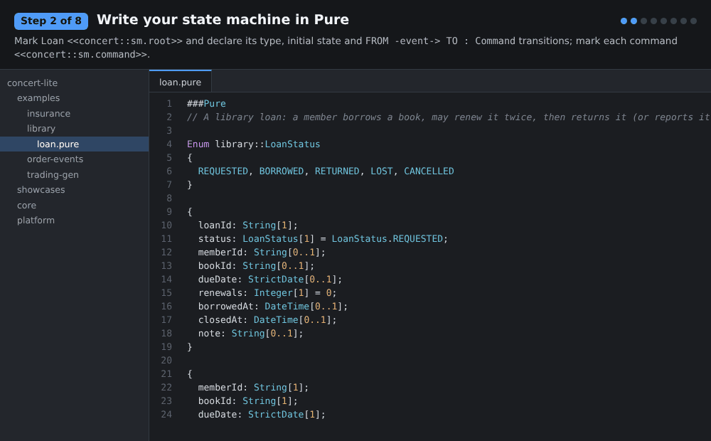
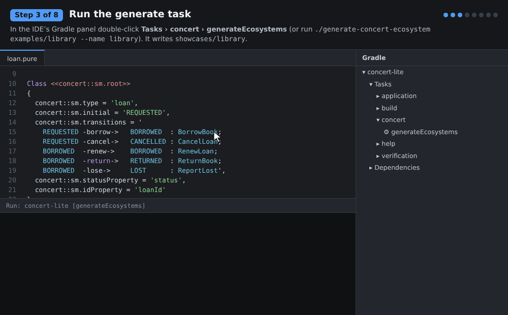
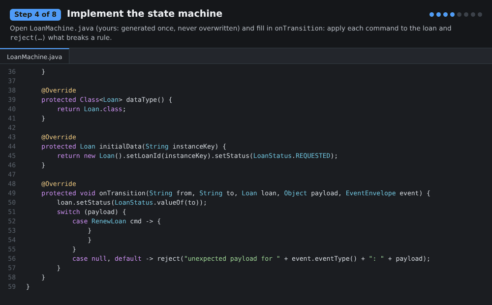
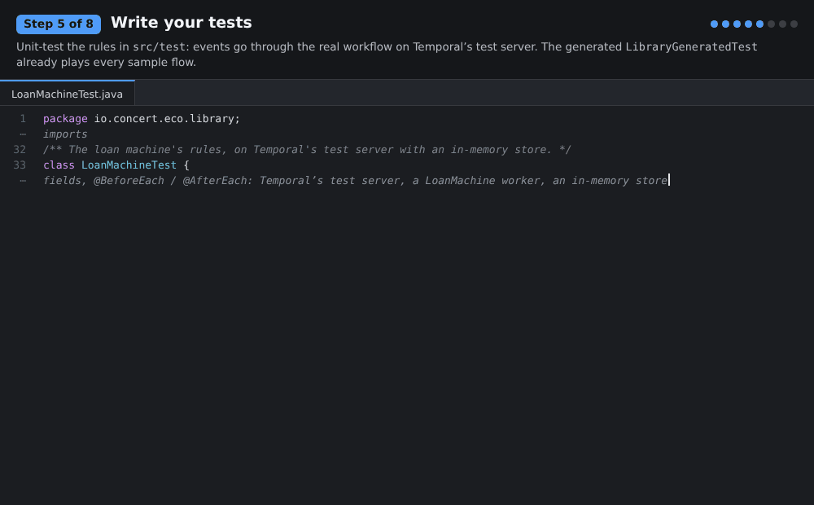
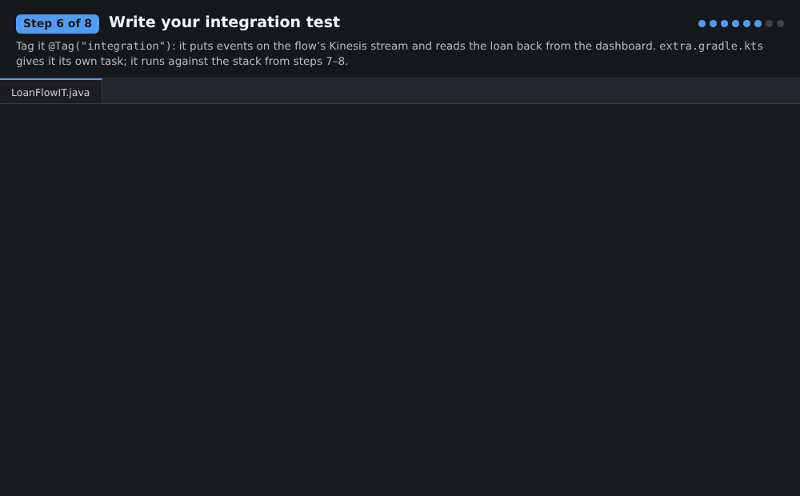
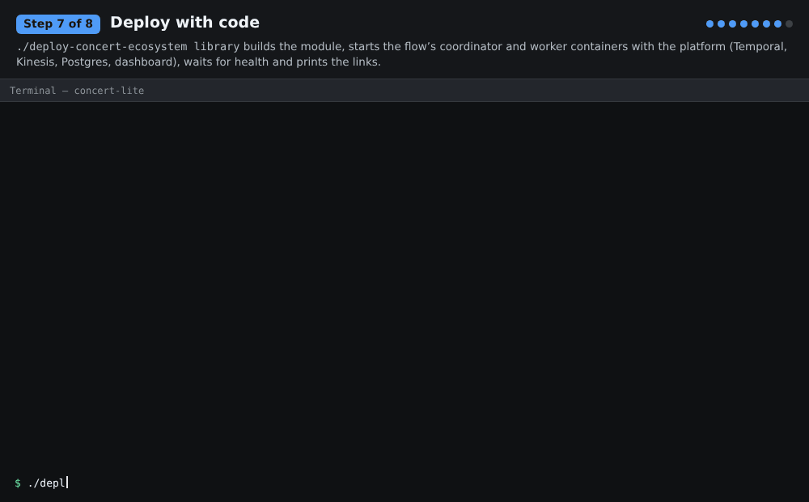
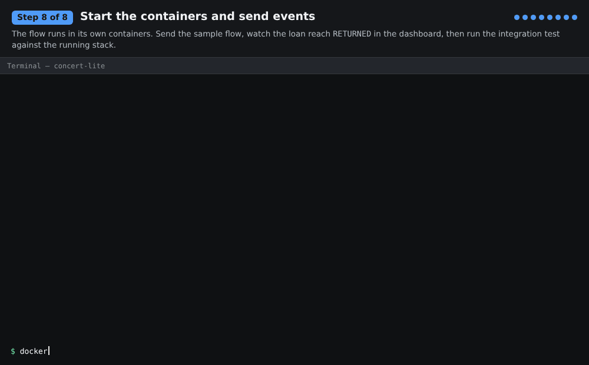

# Getting started: your first state machine flow

Eight steps from a Pure model to a flow running in containers. The guide builds a small library-loan flow; the
finished example is in the repository, so you can compare at any step:

- models: [`examples/library/loan.pure`](../../examples/library/loan.pure)
- generated module and the code you write: [`showcases/library`](../../showcases/library)

| | step | you write | you run |
|---|---|---|---|
| 1 | [Write your model in Pure](#1-write-your-model-in-pure) | `examples/library/loan.pure` | |
| 2 | [Write your state machine in Pure](#2-write-your-state-machine-in-pure) | `concert::sm` annotations | `./generate-concert-ecosystem check` |
| 3 | [Run the generate task](#3-run-the-generate-task) | | Gradle **generateEcosystems** |
| 4 | [Implement the state machine](#4-implement-the-state-machine) | `LoanMachine.java` | |
| 5 | [Write your tests](#5-write-your-tests) | `LoanMachineTest.java` | `./gradlew :library:test` |
| 6 | [Write your integration test](#6-write-your-integration-test) | `LoanFlowIT.java`, `extra.gradle.kts` | |
| 7 | [Deploy with code](#7-deploy-with-code) | | `./deploy-concert-ecosystem library` |
| 8 | [Start the containers and send events](#8-start-the-containers-and-send-events) | | `send-flow`, `:library:integrationTest` |

Requirements: JDK 25 and Docker (see [Quickstart](../../README.md#quickstart)).

## 1. Write your model in Pure



Make a directory under `examples/` named after your flow and describe the data in Pure:
- the entity whose life you track (`Loan`);
- an enum for its states (`LoanStatus`);
- one class per command that changes it (`BorrowBook`, `RenewLoan`, `ReturnBook`, ...).

Nothing here is Concert-specific yet.

```
Enum library::LoanStatus { REQUESTED, BORROWED, RETURNED, LOST, CANCELLED }

Class library::Loan
{
  loanId: String[1];
  status: LoanStatus[1] = LoanStatus.REQUESTED;
  bookId: String[0..1];
  dueDate: StrictDate[0..1];
  renewals: Integer[1] = 0;
  ...
}

Class library::BorrowBook { memberId: String[1]; bookId: String[1]; dueDate: StrictDate[1]; }
```

## 2. Write your state machine in Pure



The state machine is declared in the model itself, with the built-in `concert::sm` profile:
- mark the entity `<<concert::sm.root>>` and give it a type, an initial state and its transitions, written
  `FROM -event-> TO : Command`;
- mark each command `<<concert::sm.command>>`.

```
Class <<concert::sm.root>>
{
  concert::sm.type = 'loan',
  concert::sm.initial = 'REQUESTED',
  concert::sm.transitions = '
    REQUESTED -borrow->   BORROWED  : BorrowBook;
    REQUESTED -cancel->   CANCELLED : CancelLoan;
    BORROWED  -renew->    BORROWED  : RenewLoan;
    BORROWED  -return->   RETURNED  : ReturnBook;
    BORROWED  -lose->     LOST      : ReportLost',
  concert::sm.statusProperty = 'status',
  concert::sm.idProperty = 'loanId'
}
library::Loan { ... }

Class <<concert::sm.command>> library::BorrowBook { ... }
```

Check it: errors point at `file:line:col`, inside the tagged values.

```bash
./generate-concert-ecosystem check examples/library
```

Other tags cover lock keys (`locks`), terminal states and chaining machines (`emits`). See
[Declaring a state machine](../../core/ecosystem-gen/README.md#declaring-a-state-machine).

## 3. Run the generate task



In IntelliJ's Gradle tool window, double-click **concert-lite › Tasks › concert › generateEcosystems**. Without
options it generates a module from every `examples/<name>` directory. From the command line:

```bash
./gradlew generateEcosystems -Pecosystem=library
```

or

```bash
./generate-concert-ecosystem examples/library --name library
```

It writes `showcases/library` and adds the module to `settings.gradle.kts`, so **reload the Gradle project** in the
IDE afterwards. What it writes:

| file | |
|---|---|
| `LibraryModels` | Java classes for the Pure models (`Loan`, `BorrowBook`, ...) |
| `LoanSpec` | states, transitions, payload classes and lock keys |
| `LoanMachine` | **yours**: the stub you fill in. It is written once and never overwritten |
| `LibraryGeneratedTest` | binds every sample and plays every sample flow through your machine |
| `samples/` | a sample payload per event and a happy-path flow |
| `LibraryWorkerMain`, `LibraryEvents` | the worker, and the event sender behind `send` / `send-flow` |
| `compose.yml` | the flow's coordinator and worker services |

Run it again whenever the Pure model changes: everything is regenerated except your `LoanMachine`, any samples
you edited, and your own files.

## 4. Implement the state machine



Open `showcases/library/src/main/java/io/concert/eco/library/LoanMachine.java` and fill in `onTransition`:
- apply each command to the loan;
- call `reject("...")` for anything that breaks a rule. The event is refused and the loan stays as it was.

```java
case RenewLoan cmd -> {
    if (loan.getRenewals() >= MAX_RENEWALS) {
        reject("a loan can be renewed at most " + MAX_RENEWALS + " times");
    }
    if (!cmd.getDueDate().isAfter(loan.getDueDate())) {
        reject("the new due date must be after " + loan.getDueDate());
    }
    loan.setDueDate(cmd.getDueDate()).setRenewals(loan.getRenewals() + 1);
}
```

This is plain code, run by the worker's `ApplyTransition` activity on a fresh machine for each event, loaded from the
store and committed in one transaction. Take the time from `now()`, the transition's timestamp, and keep decisions
free of side effects: a decision may run more than once for one event (after a retry or a conflict). Only the worker changes entity state. The coordinator just orders and delivers events.

## 5. Write your tests



[`LoanMachineTest`](../../showcases/library/src/test/java/io/concert/eco/library/LoanMachineTest.java) runs events
through the real workflow on Temporal's test server with an in-memory store, then checks what was accepted and the
loan's data:

```java
@Test
void aLoanCanBeRenewedTwice() {
    send("L-2", "borrow", BORROW);
    assertTrue(send("L-2", "renew", "{\"dueDate\":\"2026-12-15\"}").accepted());
    assertTrue(send("L-2", "renew", "{\"dueDate\":\"2026-12-29\"}").accepted());

    TransitionResult third = send("L-2", "renew", "{\"dueDate\":\"2027-01-12\"}");

    assertFalse(third.accepted());
    assertEquals("2026-12-29", data("L-2").path("dueDate").asText());
}
```

```bash
./gradlew :library:test
```

The generated `LibraryGeneratedTest` runs too: it plays `samples/flows/*.json` through your machine, so a flow
file you add there becomes a test.

## 6. Write your integration test



[`LoanFlowIT`](../../showcases/library/src/test/java/io/concert/eco/library/LoanFlowIT.java) exercises the
deployed pipeline:
1. It puts events on the flow's Kinesis stream.
2. The coordinator orders them and the worker runs `LoanMachine`.
3. The test reads the loan back from the dashboard (`/api/entities/loan:<id>`).

Tag it `@Tag("integration")`. [`extra.gradle.kts`](../../showcases/library/extra.gradle.kts) is your own build file
next to the generated one, and it does two things:
- keeps integration tests out of `test`;
- adds an `integrationTest` task that points at the local stack.

You run it in step 8, once the stack is up.

## 7. Deploy with code



```bash
./deploy-concert-ecosystem library
```

The deploy script:
1. Builds the module.
2. Starts the platform (Temporal, Kinesis on LocalStack, Postgres, the dashboard) with the flow's own coordinator
   and worker containers.
3. Waits for them to be healthy.
4. Prints the links and the commands to send events.

Options:
- `--store postgres|dynamo|spanner` picks the store;
- `--no-analytics` skips Kafka, DuckDB, ClickHouse and Deephaven.

It is safe to re-run after every change.

## 8. Start the containers and send events



The flow runs in its own containers (`library-coordinator`, `library-worker`) next to the shared platform. It also
has its own stream, task queues and lock workflows.

```bash
docker compose -f docker-compose.yml -f showcases/library/compose.yml ps
```

```bash
./showcases/library/send-flow all
```

Open http://localhost:8088/#entity/loan:LOAN-1001: the loan is `RETURNED`, with its state diagram and event history.
Then run the integration test against the running stack:

```bash
./gradlew :library:integrationTest
```

Other ways to drive and run the flow:
- Send single events with `./showcases/library/send loan borrow LOAN-2001`.
- Scale the worker with `docker compose -f docker-compose.yml -f showcases/library/compose.yml up -d --scale library-worker=2`.
- Start, stop and load the flow from the dashboard's **Flows** and **Performance** tabs.

## Next

- [ecosystem-gen README](../../core/ecosystem-gen/README.md): every `concert::sm` tag, event-style flows
  (`concert::event`), chaining machines, what is generated.
- [`examples/insurance`](../../examples/insurance) (three machines with lock keys) and
  [`examples/trading-gen`](../../examples/trading-gen) (chained machines).
- The GIFs are rendered from this example by [`render/`](render/README.md). Re-render them when the example changes.
